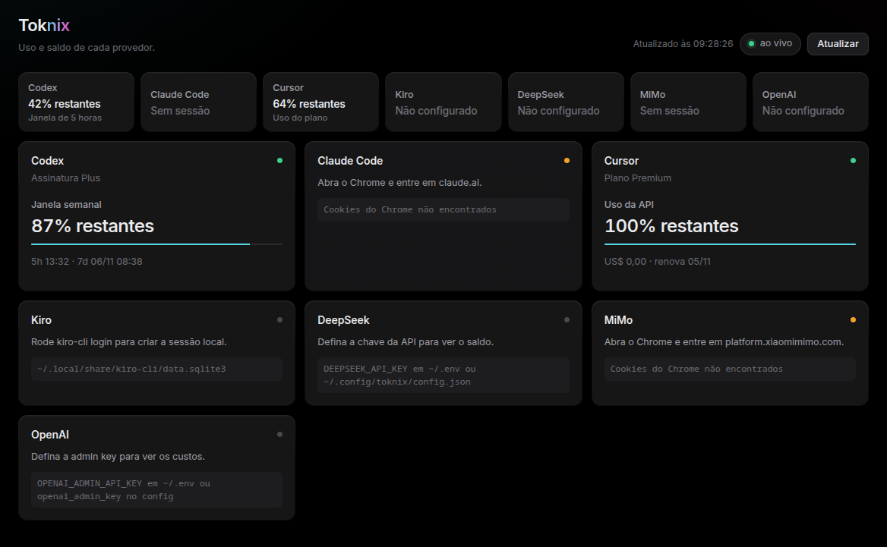

# Toknix

<p align="center">
  
</p>

Toknix monitors AI token and quota usage and opens it in a web browser. The page is served from a loopback HTTP server, the same idea as `omp stats` in [oh-my-pi](https://github.com/can1357/oh-my-pi): nothing is drawn by a desktop toolkit, so the view is not tied to a window manager.

<p align="center">
  
</p>

It tracks the same accounts as the Codex Widget it replaces:

- Codex short and weekly usage windows
- Claude Code 5-hour and weekly windows
- Cursor plan and API usage
- Kiro credits, overage and renewal
- DeepSeek balance and spend inferred from balance drops
- MiMo balance, spend and tokens from the Chrome session
- OpenAI organization spend, with an optional credit balance

## Run

```bash
cargo run --release
```

The binary also accepts `stats` as the first argument, matching the `/stats` command:

```bash
toknix
toknix stats
toknix --port 8080
toknix --no-open
toknix --summary
toknix --json
```

The dashboard listens on `http://127.0.0.1:4780` and opens in the browser. If that port is already a Toknix process, the command reuses it instead of starting a second server. If another program holds the port, Toknix tries the next free one. `Ctrl+C` stops the server. The time next to **Atualizar** is the last reading. `r` asks for a new one.

## Distribution

The Release workflow in Actions publishes a Linux AppImage and a Windows zip, so running Toknix does not require Rust. On Windows, opening `toknix.exe` from Explorer does not leave a command window open. Details are in [DISTRIBUTION.md](DISTRIBUTION.md).

Cards refresh every 60 seconds. Change that with `--refresh-seconds` (minimum 5). The page updates live over server-sent events; `r` or **Atualizar** asks for a new reading.

## Authentication

Toknix does not ask you to log in again. It reuses the sessions already on the machine.

| Provider | Source |
| --- | --- |
| Codex | `~/.codex/auth.json`. A 401 refreshes the token and writes the new tokens back, mode `600`. |
| DeepSeek | `DEEPSEEK_API_KEY`, `~/.env`, or the config file. Spend is inferred from balance drops. |
| Claude Code | Chrome cookies for `claude.ai`. |
| MiMo | Chrome cookies for `platform.xiaomimimo.com`. |
| Kiro | Read-only token in the Kiro CLI database. Toknix never refreshes it. |
| Cursor | Read-only token in the Cursor state database. A refreshed access token stays in memory for this process and is not written back. |
| OpenAI | Admin key (`sk-admin-…`) with `api.usage.read`. |

Chrome cookies use the Safe Storage secret from the Secret Service on Linux (or the macOS keychain) and, failing that, Chromium's `peanuts` password. The cookie database is copied before it is read, so a running Chrome does not block the scan. Decrypted cookies stay in memory.

## Configuration

Flags win, then the process environment, then `~/.env`, then the config file. `TOKNIX_CONFIG` and `CODEX_WIDGET_CONFIG` select the file. Otherwise Toknix reads `~/.config/toknix/config.json` when it exists, and falls back to `~/.config/codex-widget/config.json` so an existing widget setup keeps working.

```json
{
  "deepseek_api_key": "sk-...",
  "deepseek_base_url": "https://api.deepseek.com",
  "deepseek_state_file": "~/.local/state/toknix/deepseek-spend.json",
  "deepseek_spent_baseline": "12.34",
  "mimo_chrome_profile": "Default",
  "claude_chrome_profile": "Default",
  "openai_admin_key": "sk-admin-...",
  "openai_credits_purchased": "50.00",
  "openai_credits_since": "2026-09-01"
}
```

```bash
chmod 600 ~/.config/toknix/config.json
```

An existing DeepSeek ledger at `~/.local/state/codex-widget/deepseek-spend.json` is reused until a Toknix ledger exists. Pass `--deepseek-spent-baseline` for spend that happened before monitoring started. OpenAI has no balance endpoint; `openai_credits_purchased` is what turns tracked spend into a remaining balance.

Useful flags:

```bash
toknix --auth-file ~/.codex/auth.json
toknix --base-url https://chatgpt.com/backend-api
toknix --deepseek-api-key sk-...
toknix --openai-admin-key sk-admin-...
toknix --openai-credits-purchased 50.00
toknix --claude-chrome-profile Default
toknix --mimo-chrome-profile Default
toknix --host 127.0.0.1 --port 4780
```

## Security

- The server binds to loopback unless `--host` says otherwise.
- Tokens, API keys and cookies are not written to the page or the log.
- Codex credentials are sent only to the ChatGPT usage endpoint and the OpenAI token endpoint.
- The DeepSeek key is sent only to `https://api.deepseek.com/user/balance`.
- The OpenAI admin key is sent only to the organization costs endpoint.
- Claude and MiMo cookies are sent only to their own sites.
- The Kiro token is sent only to the CodeWhisperer usage endpoint.
- Keep the config file out of version control.

If a credential may have leaked, revoke it and sign in again.
